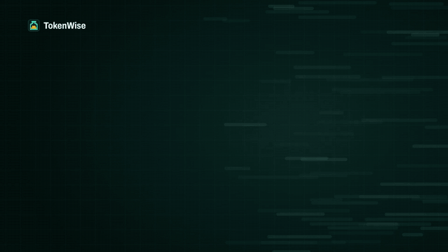
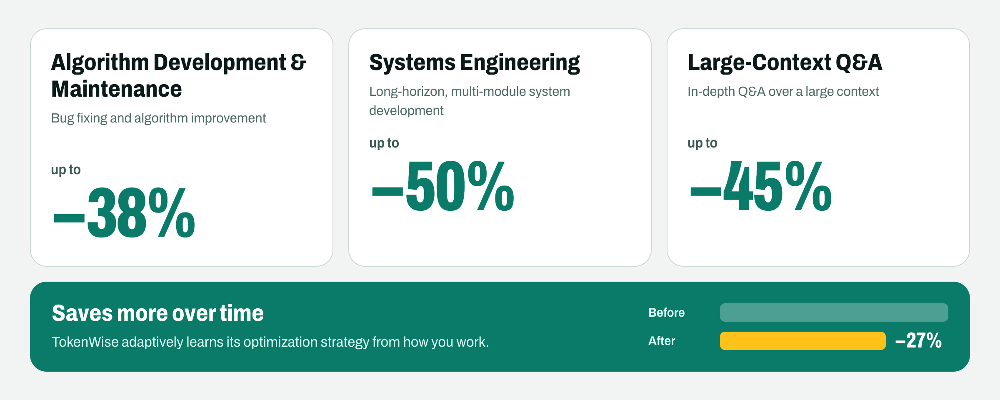
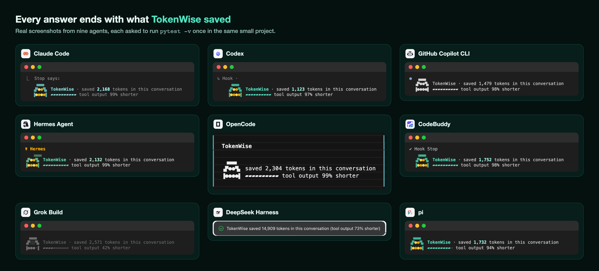

<div align="center">

<h1>
  
  TokenWise: Make every token count for your agent
</h1>

<p>
  <a href="LICENSE"></a>
  
</p>

**English** · [简体中文](docs/zh/README.md)

### The self-evolving token layer for AI agents

</div>

<p align="center"><a href="https://youtu.be/9p36ZR2rNtE"></a></p>
<p align="center"><sub>▶ <a href="https://youtu.be/9p36ZR2rNtE">Watch the video on YouTube</a> · 35 seconds</sub></p>

## Why TokenWise?

**Your agent pays for every token it reads, and much of it is noise.**

Today's agents face:
- 🗑️ **Redundant context:** repeated and irrelevant information crowds the
  context and drives up the cost.
- 📈 **Growing context:** the longer the conversation, the more every turn pays
  again for everything piled up before it.
- 🔒 **Rigid rules:** existing optimizations rely on fixed rules that don't fit
  your project.
- 🧩 **Siloed agents:** each agent handles it on its own, and nothing is shared.

**TokenWise keeps the noise out, so the model reads only what it needs.**

- **Visible savings.** Shows the tokens saved in every conversation, live.
- **Saves more the longer you use it.** It learns new ways to optimize.
- **Cross-platform.** Works across many agent platforms.

## 📊 Results

<p align="center"></p>

<sub>From our paper's evaluation; the paper is coming soon.</sub>

## 🤖 Supported agents

<table width="100%">
  <tr>
    <td align="center" width="16%"><br><strong>Claude Code</strong></td>
    <td align="center" width="16%"><br><strong>Codex</strong></td>
    <td align="center" width="16%"><br><strong>GitHub Copilot CLI</strong></td>
    <td align="center" width="16%"><br><strong>Hermes Agent</strong></td>
    <td align="center" width="16%"><br><strong>OpenCode</strong></td>
    <td align="center" width="16%"><br><strong>CodeBuddy</strong></td>
  </tr>
  <tr>
    <td align="center" width="16%"><br><strong>Grok Build</strong></td>
    <td align="center" width="16%"><br><strong>DeepSeek Harness</strong></td>
    <td align="center" width="16%"><br><strong>pi</strong></td>
    <td align="center" width="16%"><br><strong>Any shell</strong></td>
    <td align="center" width="16%"><a href="#whats-next"><br><strong>More coming</strong></a></td>
  </tr>
</table>

macOS and Linux. Each agent connects through what its own plugin interface
allows, so the depth varies a little; the details are under [How each agent is connected](#how-each-agent-is-connected).

## 🪙 See what it saved

<p align="center"></p>

<sub>Each agent built the same small ledger tool from scratch in an empty folder, running its tests as plain `pytest -v`; the numbers are from that one run.</sub>

## 🚀 Get started

Give your agent this repository and ask:

> Install TokenWise for every agent on this machine, and check each one uses it.

It works from the next command, with nothing to configure. To teach it your own
commands, type `/tokenwise` in your agent (`$tokenwise` in Codex, `@tokenwise`
in OpenCode and DeepSeek Harness, `/skill:tokenwise` in pi).

Or do it yourself (Node.js 22 and pnpm; TokenWise is not on npm yet):

```sh
git clone https://github.com/HKUDS/TokenWise.git
cd TokenWise && pnpm install && pnpm build
npm install -g ./packages/cli
tokenwise setup        # finds your agents and adds TokenWise to each
tokenwise doctor --probe   # asks each agent to run one command and checks TokenWise saw it
```

## 📰 News

- **2026-11** · Every answer ends with what TokenWise saved, in all nine agents;
  a new logo, and a 35-second video.
- **2026-10** · TokenWise is open source: self-evolution reachable from every agent,
  and one-command setup.

## What's next

- More agents: Cursor, Gemini CLI, Kimi Code and others.
- More built-in rules for common tools, each one checked on real output.
- The paper behind TokenWise, with a full evaluation.

## For agents and the curious

<details>
<summary><strong>Install by hand, agent by agent</strong></summary>
<br>

From the checkout, after `npm install -g ./packages/cli`:

```sh
pi install "$PWD/adapters/pi"                                   # pi
dsh plugin --profile web add -w "$PWD/adapters/dsh"             # DeepSeek Harness (your profile)
claude plugin marketplace add "$PWD" && claude plugin install tokenwise@tokenwise
codex plugin marketplace add "$PWD" && codex plugin add tokenwise@tokenwise    # then trust its hooks in /hooks
codebuddy plugin marketplace add "$PWD" && codebuddy plugin install tokenwise@tokenwise
grok plugin marketplace add "$PWD" && grok plugin install tokenwise@tokenwise --trust
copilot plugin marketplace add "$PWD" && copilot plugin install tokenwise@tokenwise

# OpenCode
mkdir -p ~/.config/opencode/plugins
cp adapters/opencode/dist/index.js ~/.config/opencode/plugins/tokenwise.js

# Hermes Agent
mkdir -p ~/.hermes/plugins
cp -R adapters/hermes/tokenwise ~/.hermes/plugins/tokenwise
hermes plugins enable tokenwise && hermes config set context.engine tokenwise

# The tokenwise skill, where each agent reads skills
cp -R skills/tokenwise ~/.claude/skills/            # Claude Code; likewise ~/.codebuddy/skills, ~/.grok/skills,
                                                    # ~/.config/opencode/skills, ~/.hermes/skills and ~/.copilot/skills
cp -R skills/tokenwise ~/.agents/skills/            # Codex, pi and DeepSeek Harness

# Anything else: wrap the command
tokenwise run -c 'cargo test'
```

`tokenwise setup` runs these for you; `tokenwise setup --dry-run` only prints them.

</details>

<details>
<summary><strong id="how-each-agent-is-connected">How each agent is connected</strong></summary>
<br>

| Agent | Context on demand | Learning from inside the agent |
|---|---|---|
| pi 1.1+ | in-process; TokenWise writes the compacted context | `/tokenwise` panel |
| DeepSeek Harness 0.2.x | in-process; TokenWise writes the compacted context | Plugins page, **Learn now** |
| OpenCode 1.19+ | in-process; TokenWise writes the compacted context | `tokenwise learn` |
| Hermes Agent 0.22+ | Python plugin and context engine | `tokenwise learn` |
| Claude Code 2.1+ | hooks; the catalog follows Claude's own summary | `/tokenwise:learn` |
| Codex 0.162+ | hooks; the catalog follows Codex's own summary | `$tokenwise learn` |
| CodeBuddy 2.175+ | hooks and a mod that rewrites the stored summary | `/tokenwise:learn` |
| Grok Build 1.0+ | hooks; the catalog follows Grok's own summary | `/tokenwise:learn` |
| GitHub Copilot CLI 1.0+ | hooks; shell output only (Copilot compacts with its own summary) | `tokenwise learn` |
| Any agent or shell | `tokenwise run`, recall over MCP | `tokenwise learn` |

Every agent also gets the `tokenwise` skill: `/tokenwise`, `$tokenwise` in Codex,
`@tokenwise` in OpenCode and DeepSeek Harness, `/skill:tokenwise` in pi. Each agent's folder under [`adapters/`](adapters) has the details;
[docs/adapters.md](docs/adapters.md) shows how to connect another agent.

</details>

<details>
<summary><strong>Commands</strong></summary>
<br>

| Command | What it does |
|---|---|
| `tokenwise setup [agent...]`, `uninstall [--purge]` | add TokenWise to your agents, or take it out |
| `tokenwise saved [--month\|--all]` | what TokenWise saved you, as a pixel jar in the terminal (`--json` for the numbers) |
| `tokenwise dashboard [--port N] [--no-open]` | the same jar as a page in your browser, filling as it saves |
| `tokenwise report [--host H] [--session S]` | the detailed numbers behind `saved`, per session or agent, for troubleshooting |
| `tokenwise checkup` | what it shortens, its learned rules, and the commands worth teaching it |
| `tokenwise teach "<command>"`, `teach check\|preview\|keep\|drop` | teach it one command from your own agent |
| `tokenwise preview "<command>"` | a recorded output of that command: the original and what the model reads |
| `tokenwise learn --learner L`, `learn status\|cancel` | start learning in the background, follow it, stop it |
| `tokenwise rules [list\|off\|on\|rollback]` | the learned rules |
| `tokenwise filters` | every built-in rule and what it guarantees to keep |
| `tokenwise recall <id>` | read a set-aside original back |
| `tokenwise run -c '<command>'` | run any command through TokenWise |
| `tokenwise doctor [--probe]` | whether TokenWise works in each of your agents (`--probe`: each runs one command to prove it), configuration, what each agent supports |

`tw` works in place of `tokenwise` everywhere.

</details>

<details>
<summary><strong>Configuration and privacy</strong></summary>
<br>

Nothing needs configuring. To change something, write `~/.tokenwise/config.json`;
`TOKENWISE_DISABLE=1` switches everything off for one run. Every `TOKENWISE_*`
setting can also be written `TW_*` (`TW_HOME`, `TW_DISABLE`): Codex and DSH drop
variables with TOKEN in their name from the shells they run.

Everything stays on your machine: originals are readable only by you and deleted
after 14 days. The one thing that leaves your machine is a learning round you
start yourself: the learner is your own agent, so the recorded output it reads
goes to that agent's model provider, as it did when the agent first ran the
commands. Set `"evidence": false` to record nothing.

</details>

[Architecture](docs/architecture.md) · [Adding an agent](docs/adapters.md) · [Changelog](CHANGELOG.md) · [Media kit](media/README.md) · [MIT License](LICENSE)

<sub>Icons made by <a href="https://www.magnific.com" title="Magnific">Magnific</a> from <a href="https://www.flaticon.com/" title="Flaticon">www.flaticon.com</a>. Agent icons belong to their products; sources in <a href="media/agents/NOTICE.md">media/agents/NOTICE.md</a>.</sub>
